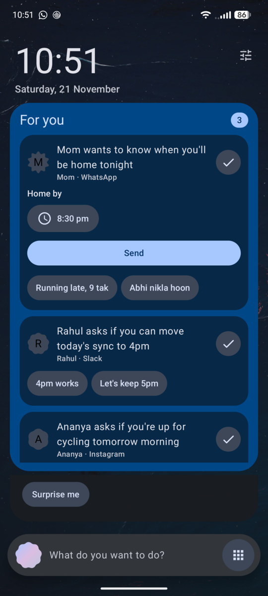
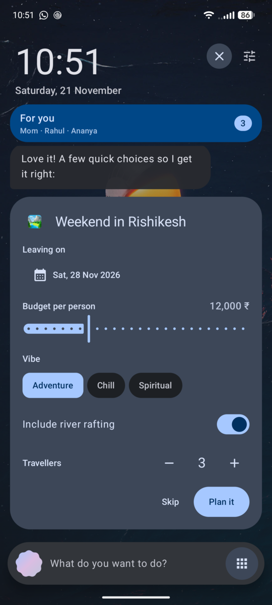
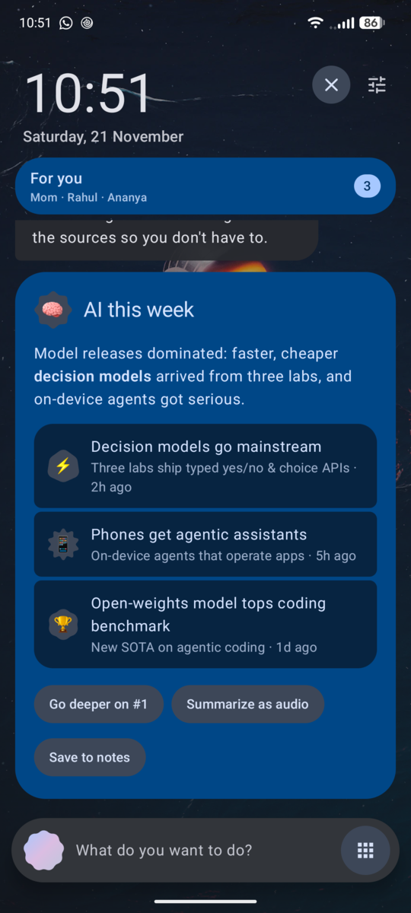
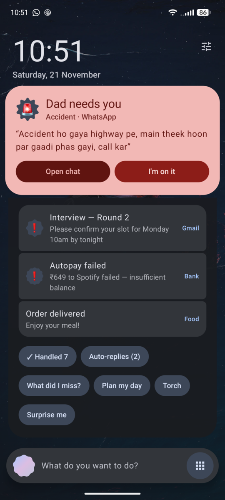
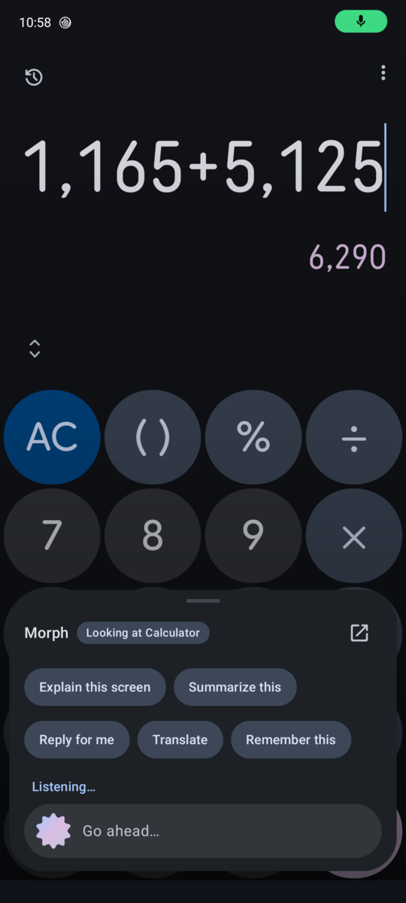
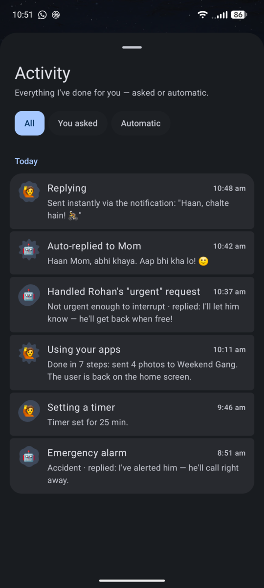
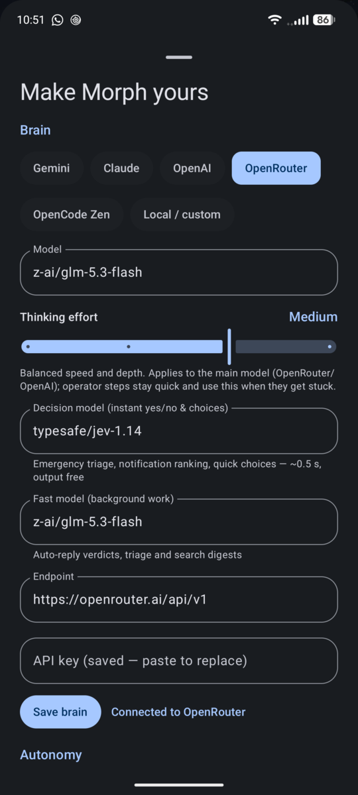
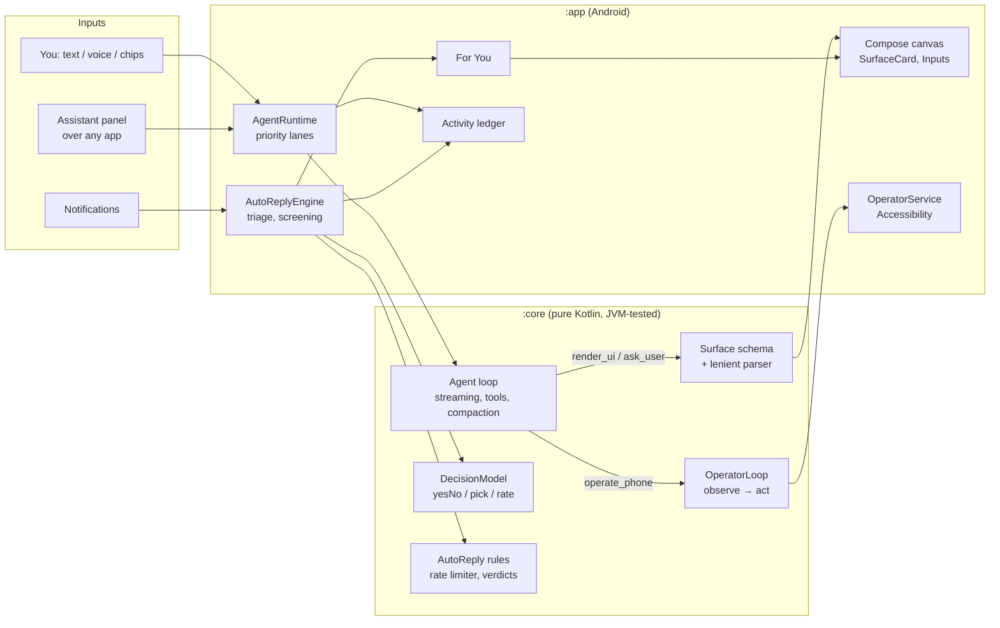

<div align="center">

# Morph

**An Android home screen with no icon grid.**<br>
You say what you want, and an AI agent does it. It draws native UI when it needs to show you something or ask you something, and it quietly handles your messages while you're busy.

[](https://github.com/BhupendraSharma-eng/morph/actions/workflows/ci.yml)


[](LICENSE)

&nbsp;
&nbsp;
&nbsp;


</div>

> Every screenshot uses Morph's built-in **demo mode**. All the people, messages and notifications in them are fictional.

---

## Why

Phones still make you go to the app, find the screen and do the task yourself. Assistants answer in a chat bubble and stop there. Morph is built on three ideas:

1. **Intent over icons.** The home screen is a single input ("What do you want to do?") over a canvas. Apps are still one search away, but most things don't need you to open one.
2. **Generative UI.** The agent responds with native Material 3 components rather than only text: lists, cards, sliders, date pickers and toggles. When it needs details from you, it **draws the form and waits** for your answer.
3. **Proactive, but trustworthy.** It handles routine messages, wakes you only for real emergencies, and tells you what people actually need from you. Every action goes in an Activity log, and a Stop button and an autonomy dial put you in control.

## What it can do

| | Capability | How it works |
|---|---|---|
| 💬 | **Talk to your phone** | Type or speak. Local fast paths (app names, torch, timers) answer instantly with no model call. Everything else goes to a streaming agent loop with tools. |
| 🧩 | **Agent-drawn interfaces** | `render_ui` lets the model compose a typed `Surface` (text, lists, chips, images, progress), which is rendered natively and animated with Material motion. |
| 📝 | **Asks with UI, not questions** | `ask_user` pauses the turn and shows a form the agent designed (date/time pickers, sliders, steppers, choices, toggles, text). Your answers come back to the agent as structured JSON. |
| 📱 | **Operator mode: uses apps for you** | An AccessibilityService reads any app's UI tree, and the agent taps, types and scrolls through multi-step tasks, e.g. *"send the trip photos to Weekend Gang on WhatsApp"*. A live overlay shows each step with a big Stop button. |
| 🤖 | **Auto-replies** | Rules such as *"reply to family while I'm at work"* send replies straight through the notification's reply action, so Morph never has to open the app. Bursts of messages are combined, and replies are rate-limited per chat. |
| 🚨 | **Emergency detection** | A decision model triages every incoming message. A real emergency (accident, medical, safety) sets off a full-screen alert, even when Do Not Disturb is on. An "URGENT 60% off" promotion doesn't. |
| 🛡️ | **Urgent-request screening** | When someone writes "call me, urgent", Morph asks what it's about. It interrupts you only if the reason holds up, and otherwise handles the request and leaves you a calm note. |
| ✨ | **For You** | Instead of a feed of notifications, you get *what people need from you*. Each item is summarised, comes with suggested replies and, where useful, an input the agent drew for it (e.g. a time picker for *"when will you be home?"*). Replies go out instantly through the notification. |
| 🔎 | **Research** | `search_news`, `web_search` (with citations) and `read_webpage`. Web content is marked untrusted before the model sees it. |
| 🎙️ | **Digital assistant** | Morph takes the system assistant role. Use the assist gesture (e.g. long-press power) to get a floating panel over any app that knows what is on screen ("Explain this screen", "Reply for me"). |
| 🔍 | **Universal search** | Apps, contacts, settings, app shortcuts and the web, all searched locally before any AI is involved. |
| 📋 | **Activity log** | Every action, whether you asked for it or it ran automatically, with when and why. |

<p align="center">
&nbsp;
&nbsp;

</p>

## Two brains: System 1 and System 2

Morph splits its thinking the way people do:

| | System 1: *decision model* | System 2: *language model* |
|---|---|---|
| Model | `typesafe/jev-1.14` via OpenRouter's Decisions API | Any OpenAI-compatible or Anthropic model (default: `z-ai/glm-5.3-flash`) |
| Output | Typed answers: yes/no probability, choice, score | Text, tool calls, UI |
| Used for | Emergency triage, urgent-request screening, notification ranking, "is this for the owner?", "should the operator end on the home screen?" | Conversation, planning, operator steps, writing replies |
| Speed / cost | ~0.5–0.7 s, ~$0.00002 per message | Seconds, normal LLM pricing |

Decisions such as "is this an emergency?" therefore come out as **calibrated probabilities with thresholds** rather than free text that has to be parsed. They are fast and cheap enough to run on *every* notification, and they can be evaluated (below).

## Measured, not vibes

All numbers come from real runs. The decision-model suites can be re-run with [`evals/decisions.py`](evals/decisions.py), and the details are in [docs/EVALS.md](docs/EVALS.md).

| What | Result |
|---|---|
| Emergency triage | **5/5 emergencies caught, 0/11 false alarms** (incl. "URGENT" promos, OTPs, impatient friends) |
| Urgent-request screening | **10/10** correct interrupt / handle / ask-again decisions |
| Operator: knowing where to finish | 10/10 real tasks end on the right screen |
| Operator step latency | 4.5 s → **0.9 s** per step at low reasoning effort (escalates only when stuck) |
| Notification ranking | 7 notifications ranked in one call: 917 ms, $0.000045 |
| Battery (idle on home) | ~0.6% of one core in the background, **0 frames rendered while hidden** |
| Memory / startup | 27 MB PSS, ~745 ms cold start |
| Unit tests (`:core`) | 42 tests: agent loop, UI parser, auto-reply rules, operator, decisions |

## Architecture



* **`:core`** has no Android dependency. The agent loop, LLM providers (OpenAI-compatible SSE + Anthropic), the generative-UI schema, the operator loop and decision models are all unit-tested on the JVM.
* **`:app`** is the launcher. It holds the Compose UI, Android capabilities exposed as tools, the notification listener, the accessibility operator, the assistant session and settings (DataStore, with the API key encrypted by an Android Keystore AES-GCM key).
* **`AgentRuntime`** runs for the whole life of the app and has priority lanes (*you > urgent > proactive > background*), so a background triage can never block what you just asked for.

More detail, including the request lifecycle, trust boundary and operator internals, is in **[docs/ARCHITECTURE.md](docs/ARCHITECTURE.md)**.

## Trust & safety

An agent that can tap through your apps and reply to your family needs hard limits:

* **Limits enforced in code, not just the prompt:** passwords are never typed, and anything that spends money always asks first, at every autonomy level.
* **Autonomy dial:** *Careful* asks before sending, posting or deleting, and before acting on anything it read online. *Balanced* asks before sending, posting or deleting. *Autonomous* carries tasks through end to end. The dial also scales the step budgets (8 → 40 agent rounds, 30 → 100 operator steps).
* **Trust boundary:** tool output that contains third-party content (web pages, messages, other apps' screens) is tagged untrusted. Before acting on it, the agent needs confirmation.
* **Visible and stoppable:** the operator shows a live overlay with a Stop button, and every action lands in the Activity log.
* **Keys stay on the device:** the API key is encrypted with an Android Keystore key, and the adb configuration receiver requires the `DUMP` permission, which only the adb shell holds.

## Build & run

Requirements: JDK 17, Android SDK (platform 37), a device running **Android 16+** (there is deliberately no backward compatibility).

```bash
git clone https://github.com/BhupendraSharma-eng/morph && cd morph
./gradlew :core:test :app:assembleRelease
adb install -r app/build/outputs/apk/release/app-release.apk
adb shell cmd package compile -m speed -f bhupendra.morph   # full AOT; sideloads have no cloud profile
```

Then set Morph as the home app and connect a brain, either in Settings or from your computer:

```bash
adb shell am broadcast -n bhupendra.morph/.ConfigReceiver \
  --es provider openrouter --es api_key "$OPENROUTER_API_KEY" --es model z-ai/glm-5.3-flash
# providers: openrouter | gemini | claude | openai | zen | local
```

Optional permissions are requested when a feature first needs them: notification access (auto-replies, For You), accessibility (operator mode), the assistant role, and the microphone.

**Demo mode** (fictional data for screenshots and presentations):

```bash
adb shell am broadcast -n bhupendra.morph/.ConfigReceiver --es demo on --es scene home   # home|research|plan|alert|activity|settings
adb shell am broadcast -n bhupendra.morph/.ConfigReceiver --es demo off
```

## Tech stack

Kotlin 2.4 · Jetpack Compose with **Material 3 Expressive** (`MotionScheme.expressive`, `MaterialShapes` morphing, `LoadingIndicator`, wavy progress, button groups) · Coroutines · kotlinx.serialization · OkHttp SSE · DataStore · Android Keystore · AccessibilityService · VoiceInteractionService · NotificationListenerService · OpenRouter (LLMs + Decisions API) · Gradle 9 / AGP 9.

## Project layout

```
core/   agent/      Agent loop, tools, autonomy, ask_user, render_ui, priority lanes
        llm/        Streaming providers (OpenAI-compatible, Anthropic), message codec
        surface/    Generative-UI schema (Surface / Block / Action) + lenient parser
        operator/   Observe → decide → act loop, loop detection, finish decisions
        decide/     Typed decision models (Jev + LLM fallback)
        automation/ Auto-reply rules, rate limiting, verdict parsing
        web/        News, web search, page reader (untrusted-content marking)
app/    ui/         Home, canvas, For You, inputs, sheets, theme, demo mode
        agent/      AgentRuntime, Activity ledger
        auto/       AutoReplyEngine, For You, urgent alerts
        operator/   AccessibilityService + overlay + operate_phone tool
        assist/     Digital assistant session + floating panel
        device/     Device tools, notifications, search, voice
evals/  Reproducible decision-model evals
docs/   Architecture, evals, screenshots
```

## Roadmap

Next up: live-updating surfaces, memory v2, proactive "moments" (morning brief, event prep), a vision fallback for apps without accessibility trees, and learned operator recipes. See [ROADMAP.md](ROADMAP.md).

## License

[MIT](LICENSE) © 2026 Bhupendra Sharma
