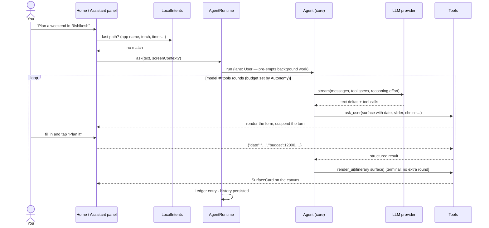
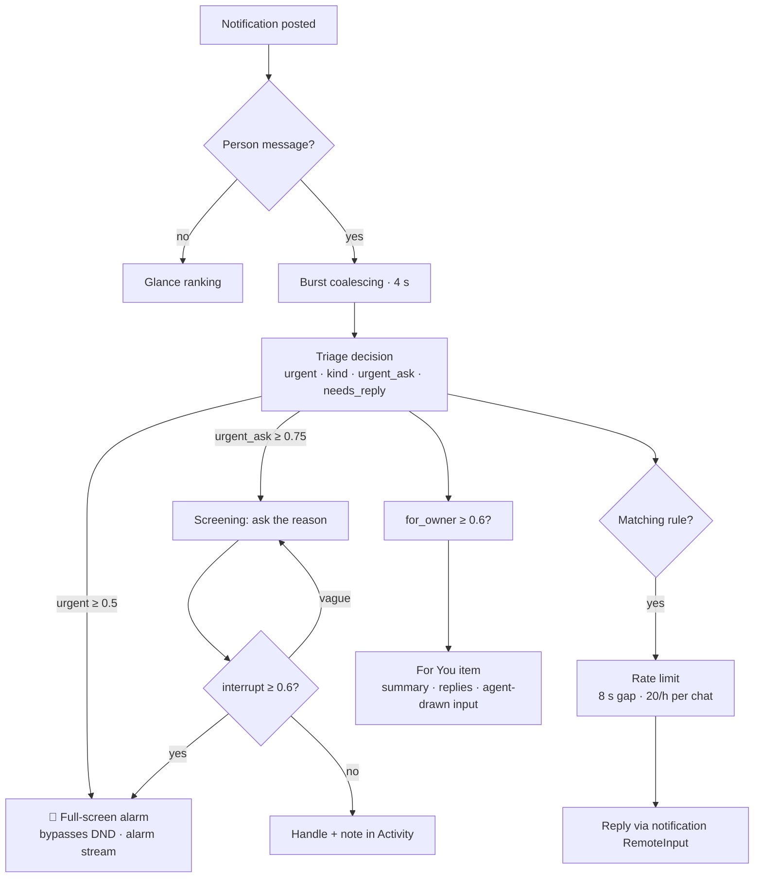
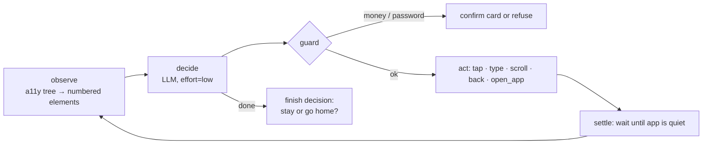

# Architecture

Morphy has two modules. **`:core`** is pure Kotlin with no Android dependency, so the agent, the UI schema, the operator loop and the decision models are all unit-testable on the JVM. **`:app`** is the launcher: Compose UI plus the Android capabilities, which are exposed to the agent as tools.

## 1. A request, end to end



* **Local first.** `LocalIntents` answers app launches, torch, timers and similar requests with no model call. Universal search (apps, contacts, settings, shortcuts) is local too.
* **Streaming.** `OpenAICompatProvider` (SSE) and `AnthropicProvider` stream text and tool calls, and finish reasons come through (a `length` cut-off triggers a nudge-and-retry rather than a silent stop).
* **Terminal tools.** If a round ends with only `render_ui`, the loop stops, which saves one model call per UI answer.
* **Compaction.** At the start of each turn, old tool results are trimmed (to ~600 chars), so long conversations stay cheap without losing the thread.
* **Persistence.** The canvas and conversation history survive process death, and the agent resumes the thread after a restart.

## 2. Generative UI: `Surface`

The model composes UI as data:

```kotlin
Surface(id, title, icon, tone, blocks = listOf(
    Block.Text("Markdown-ish **text**"),
    Block.ListBlock(items),          // tappable rows with actions
    Block.Chips(options),            // quick replies / follow-ups
    Block.Input("budget", InputKind.Slider, "Budget", min = 5000f, max = 30000f, unit = "₹"),
    …
), form = FormSpec("Plan it", "Skip"))
```

* `SurfaceParser` is deliberately **lenient**: models drift in field names and shapes, and a malformed block is dropped rather than failing the whole card. `AskUserShapesTest` pins the shapes seen from real models.
* `Action` is a closed set (`Say`, `Launch`, `OpenUrl`, `OpenNotification`, `RunTool`, `OpenSettings`, …), so a surface can never do something the app didn't define.
* Input kinds: text, multi-line text, slider, toggle, single choice, multi choice, date, time, stepper and rating, rendered with Material 3 Expressive components in `ui/Inputs.kt`.

## 3. AgentRuntime and priority lanes

`AgentRuntime` lives for the whole app process and is shared by the home screen and the floating assistant, so both views see the same conversation and canvas.

`PriorityLane` orders work as **User > Urgent > Proactive > Background**. A message triage running in the background never delays what you just typed, and an emergency triage is never stuck behind a notification digest.

## 4. Two kinds of model calls

```kotlin
// System 1: typed decision, ~0.5 s, fractions of a cent
val r = decisions.decide(state) {
    yesNo("urgent", "Is someone in danger right now…?", yes = "…", no = "…")
    pick("kind", "What kind of message is this?", "emergency" to "…", "request" to "…")
}
if (r.yes("urgent") >= 0.5) UrgentAlert.fire(…)
```

* `DecisionModel` is an interface. `JevDecisions` calls OpenRouter's `/api/alpha/decisions` (question types `noul` / `choice` / `score`). `LlmDecisions` emulates it with any chat model, as a fallback.
* System 2 (the chat LLM) is configured separately: a **main** model for conversation and operator work, and a **fast** model for background summaries and replies. A reasoning-effort slider controls the main model.

## 5. Messages: auto-reply, triage, screening, For You



* **Replies never open the app.** They go through the notification's `RemoteInput` action, the same mechanism as the shade's inline reply. The `reply_in_chat` tool lets the agent use this path too.
* **Message identity** is `text@timestamp`, so repeated identical messages ("hello?", "hello?") are not mistaken for duplicates, while a notification being re-posted is.
* **For You** replaces "N messages handled" with what actually needs you. Each item has a one-line summary, suggested replies and, where useful, an input the agent drew (e.g. a time picker with a reply template like *"{value} tak ghar aa jaunga"*). Items clear when you reply from anywhere.

## 6. Operator mode



* **Observe.** `OperatorService` (an AccessibilityService) flattens the active window into at most 160 numbered elements with roles and flags (`{tap,edit,scroll,checked}`). Password fields are masked.
* **Event-driven settling.** After each action the loop waits until the app has been quiet for 300 ms (capped at 1.5–3.5 s) instead of sleeping for a fixed time.
* **Speed.** Steps run at low reasoning effort (~0.9 s) and escalate to the user's effort only when the agent is stuck or looping.
* **Loop detection.** Repeated (screen, action) pairs are counted, and the agent is told to try something else.
* **Finishing.** A decision call chooses between staying on the result (e.g. a search result you wanted to see) and returning home (e.g. after sending a message).
* **Guards in code.** Taps matching the autonomy level's confirm pattern (always including payment words) need your approval, and typing into password fields is refused.

## 7. Trust boundary

Every `ToolSpec` declares a **risk** (`Read`, `Act`, `Handoff`) and whether its output is **untrusted** (web pages, messages, another app's screen). Once a turn has read untrusted content, the autonomy level decides which state-changing tools need a confirm card (`Autonomy.gatesAfterUntrusted`). Web content is also prefixed with an explicit untrusted marker before the model sees it.

## 8. Digital assistant

`MorphyVoiceService` and `AssistantSession` give Morphy the system assistant role. The floating panel is a Compose view inside a `VoiceInteractionSession`.

* **Screen context.** The session uses Android's `AssistStructure` when it is provided. When the platform withholds it, `onPrepareToShowSession` snapshots the foreground app through the operator's accessibility service *before* the panel covers it.
* **Voice.** `MorphyRecognitionService` proxies to the system speech recognizer, so Morphy can hold the assistant role without shipping its own recognizer.

## 9. Settings & secrets

* DataStore stores preferences. The API key is encrypted with an **Android Keystore AES-GCM** key and never leaves the device except in requests to the chosen provider.
* `ConfigReceiver` allows configuration from a computer and is protected by the `DUMP` permission, which only the adb shell holds.
* Release signing reads the keystore location from the environment (`MORPH_KEYSTORE_FILE`). No key material is in the repository.

## 10. Observability

The Activity ledger records every action (what, why, origin: you / automation / proactive). Development trace files (`operator-trace.log`, `autoreply-trace.log`, `foryou-trace.log`) and crash reports are written to the app's external files directory, and a crash shows an "I crashed last time" card on the next start.
